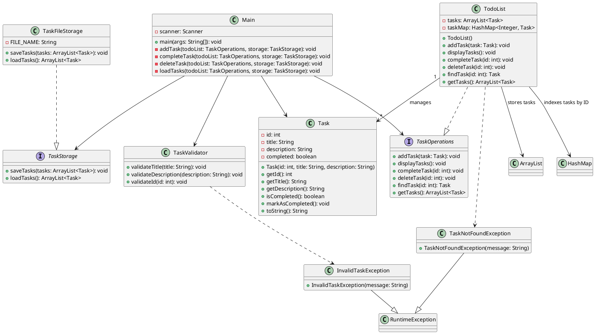

# TO-DO LIST MANAGER – UML

## 1. Class Overview

### Task
Represents a single task in the application.
- `id: int`
- `title: String`
- `description: String`
- `completed: boolean`

### TodoList
Implements `TaskOperations` and manages the application's tasks.
- `tasks: ArrayList<Task>`
- `taskMap: HashMap<Integer, Task>`

### TaskFileStorage
Implements `TaskStorage` and handles saving and loading tasks from a file.

### TaskValidator
Validates task titles, descriptions, and IDs.

### Main
Contains the main menu and coordinates user interaction, task management, and file storage.

### Interfaces
- `TaskOperations` – defines the operations available for managing tasks.
- `TaskStorage` – defines the operations for saving and loading tasks.

### Custom Exceptions
- `TaskNotFoundException` – extends `RuntimeException`.
- `InvalidTaskException` – extends `RuntimeException`.

## 2. Relationships

- `Main` uses `TaskOperations` and `TaskStorage`.
- `TodoList` implements `TaskOperations`.
- `TaskFileStorage` implements `TaskStorage`.
- `TodoList` manages multiple `Task` objects.
- `TodoList` uses an `ArrayList` to store tasks.
- `TodoList` uses a `HashMap` to find tasks by ID.
- `TaskValidator` uses `InvalidTaskException` when input is invalid.
- `TodoList` uses `TaskNotFoundException` when a task cannot be found.
- Both custom exceptions extend `RuntimeException`.

## 3. UML Class Diagram (PlantUML)

## 4. Collections Used

- `ArrayList<Task>` – stores the tasks in a list.
- `HashMap<Integer, Task>` – stores tasks using their IDs as keys, allowing efficient lookup.